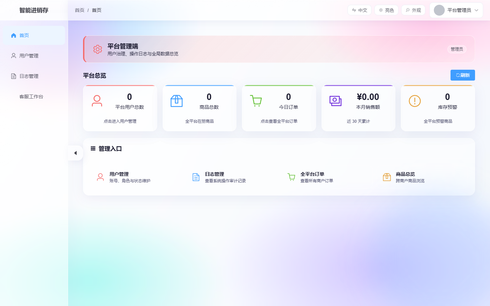
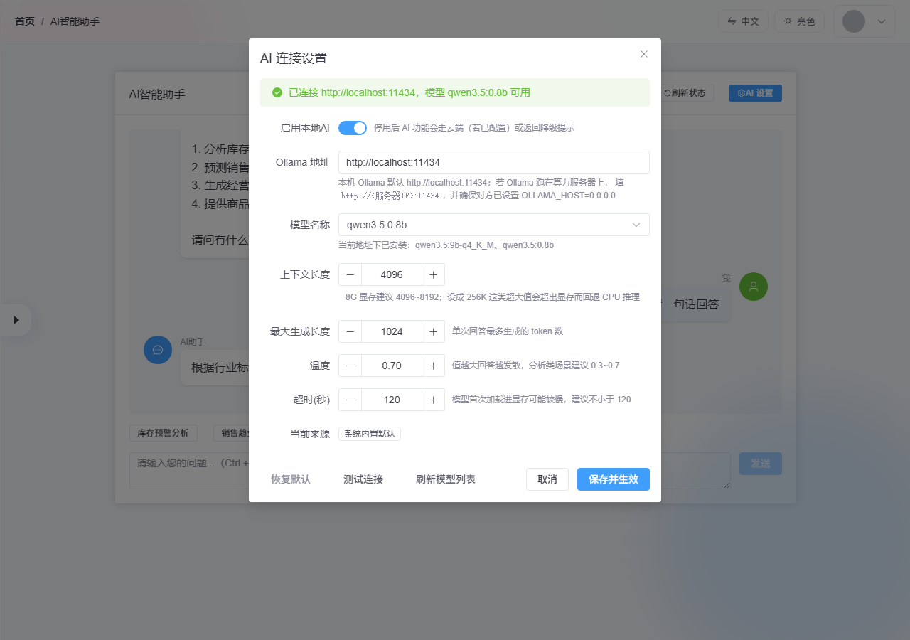
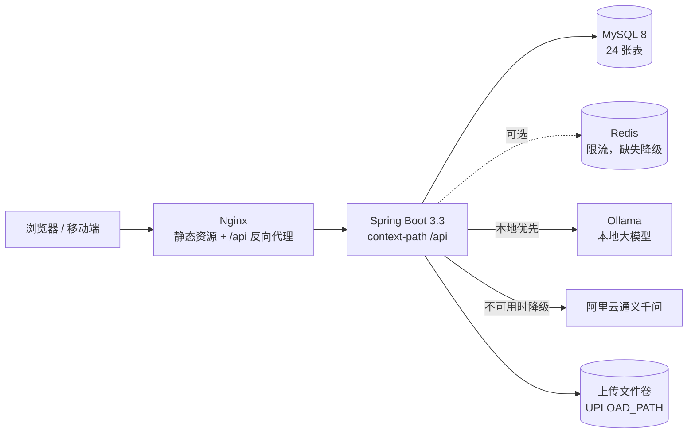

<div align="center">

# Intelligent Storage

**面向中小企业的 AI 智能进销存与商品推荐系统**

前端 Vue 3 · 后端 Spring Boot 3 · 数据库 MySQL 8 · 四角色业务闭环

[](https://github.com/CH0-0HC/intelligent-storage/actions/workflows/ci.yml)
[](LICENSE)


</div>



## 简介

Intelligent Storage 是一套前后端分离的单体应用，用一套系统同时承载 **电商交易** 与 **进销存管理** 两条链路：

> 浏览商品 → 加购 → 下单 → 付款 → 发货 → 签收 → 售后 → 客服裁定
> 采购下单 → 入库 → 库存预警 → 出库（发货扣减）→ 经营分析

四类角色各司其职：**买家（user）**、**商家（merchant）**、**平台管理员（admin）**、**客服（kefu）**。系统兼具演示与生产骨架的定位：开箱即可跑通全流程，配置好环境变量即可按生产模式部署。

---

## 核心亮点

- **完整业务闭环**：约 78 个 REST 端点、29 条前端路由、24 张数据表，覆盖交易、库存、采购、售后、客服、审计六个域。
- **多租户隔离不依赖物理外键**：全库零外键，商家数据边界由 `MerchantContext` + Service 层归属断言保证，避免外键在分库与演示数据导入上的束缚。
- **库存并发安全**：扣减走条件更新（`quantity >= ?`）+ 乐观校验，发货/签收才真正扣减，超卖与重复扣减均有测试覆盖。
- **订单状态机**：未付款订单 15 分钟自动取消（可配置），付款与超时取消之间的双向竞态有专门的幂等处理。
- **售后与客服双域**：支持整单/商品级售后、按商品配置退货期限、超期申诉走客服工单裁定（第三方角色独立于商家）。
- **AI 能力内建**：本地 Ollama 优先、云端（通义千问）自动降级的双通道；协同过滤推荐、加权移动平均销量预测、可售天数分级库存预警、经营报告生成、对话式助手。
- **工程化基础设施**：统一响应体、全局异常处理、操作日志 AOP、注解式限流（Redis 缺失时降级放行）、中英双语 i18n、玻璃拟态主题、移动端适配。
- **质量护栏**：后端 13 个测试类跑在 H2 内存库，前端 14 个测试文件 / 127 个用例（本地实测全绿），i18n 缺失键门禁 + 本地 Git 钩子 + GitHub Actions 三层校验。



## 功能矩阵

| 能力 | 管理员 | 商家 | 买家 | 客服 |
| --- | :--: | :--: | :--: | :--: |
| 商品浏览 / 详情 | ✅ | ✅ | ✅ | ✅ |
| 购物车、下单、付款、收货 | — | — | ✅ | — |
| 商品 / 库存 / 采购管理 | ✅ | ✅ | — | — |
| 订单发货 / 关闭 | ✅ | ✅ | — | — |
| 售后申请 | — | — | ✅ | — |
| 售后审批 / 退款 | ✅ | ✅ | — | — |
| 客服工单裁定 | ✅ | — | — | ✅ |
| 用户管理 / 操作日志 | ✅ | — | — | — |
| AI 分析 / 数据看板 | ✅ | ✅ | — | — |

## 技术栈

| 层次 | 选型 |
| --- | --- |
| 前端 | Vue 3.4、Vite 5、Element Plus、Pinia、Vue Router、ECharts、vue-i18n |
| 后端 | Spring Boot 3.3.2、Java 17、MyBatis-Plus 3.5、Sa-Token 1.38、Spring Security（BCrypt）、Springdoc / Knife4j |
| 数据 | MySQL 8、Redis（可选，仅限流） |
| 测试 | JUnit 5 + H2（后端）、Vitest + jsdom（前端） |
| 交付 | Docker / Docker Compose、Nginx、GitHub Actions |

## 系统架构



后端分层：`controller → service(impl) → mapper(MyBatis-Plus + XML)`，横切能力放在 `common`（统一响应、异常、分页、金额精度、日志切面、限流）与 `security`（Sa-Token 鉴权、商户上下文）。AI 相关逻辑集中在 `ai` 包，通过 `AiFacade` 屏蔽本地/云端差异。

设计取舍详见 [docs/ARCHITECTURE.md](docs/ARCHITECTURE.md)。

## 快速开始

### 方式一：Docker Compose（推荐体验）

前置：Docker 与 Docker Compose 插件。

```bash
cp .env.example .env          # 至少修改 MYSQL_ROOT_PASSWORD / DB_PASSWORD
docker compose up -d --build
```

- 前端： <http://localhost:8088>
- 后端 API： <http://localhost:8080/api>
- 首次启动会自动执行 `backend/src/main/resources/db/init.sql`（建库 + 24 张表 + 演示账号与示例商品）

### 方式二：本地开发

前置：JDK 17、Maven 3.9+、Node.js 22 LTS（含 npm，见 `.nvmrc`）、MySQL 8（Redis 可选）。

```bash
# 1) 初始化数据库（脚本内含建库语句，可直接整份执行）
mysql -uroot -p < backend/src/main/resources/db/init.sql

# 2) 启动后端（默认 http://localhost:8080/api）
cd backend && mvn -B spring-boot:run

# 3) 启动前端（默认 http://localhost:5173，已配置 /api 与 /uploads 代理）
cd frontend && npm ci && npm run dev
```

接口文档（默认 dev 环境）：<http://localhost:8080/api/swagger-ui.html>（Knife4j 增强版：`/api/doc.html`）。

### 演示账号

| 角色 | 账号 | 密码 |
| --- | --- | --- |
| 管理员 | `admin` | `admin123` |
| 商家 | `merchant` | `merchant123` |
| 买家 | `user` | `user123` |
| 客服 | `kefu` | `kefu123` |

> 以上账号仅用于演示，哈希写在 `init.sql` 中，**切勿用于生产环境**。

## 配置项

| 变量 | 说明 | 默认值 |
| --- | --- | --- |
| `DB_URL` | JDBC 连接串（prod 必填） | — |
| `DB_USERNAME` / `DB_PASSWORD` | 数据库账号口令（prod 必填） | `root` / `12345678`（仅 dev） |
| `REDIS_HOST` / `REDIS_PORT` | 限流用 Redis，不可用自动降级 | `localhost` / `6379` |
| `UPLOAD_PATH` | 上传文件根目录（prod 必填，建议独立数据卷） | `./uploads` |
| `CORS_ALLOWED_ORIGINS` | 允许的前端来源，逗号分隔（prod 必填） | — |
| `AI_PROVIDER` | `auto` / `local` / `cloud` | `auto` |
| `OLLAMA_BASE_URL` / `OLLAMA_MODEL` | 本地模型地址与模型名 | `http://localhost:11434` / `qwen3.5:0.8b` |
| `ALIYUN_API_KEY` / `ALIYUN_API_SECRET` | 云端 AI（通义千问）凭据，可留空 | 空 |

完整说明见 [docs/DEPLOYMENT.md](docs/DEPLOYMENT.md)。

## 测试与质量门禁

```bash
cd backend  && mvn -B test                 # 后端单测（H2 内存库，不依赖 MySQL/Redis）
cd frontend && npm ci && npm test          # 前端 vitest
node scripts/check-i18n-keys.mjs           # i18n 缺失键（应为 0）
```

- 本地可选钩子：`node scripts/install-git-hooks.mjs`，安装 `pre-commit`（i18n + 前端单测）与 `pre-push`（后端单测 + 前端构建）。
- 远端：`.github/workflows/ci.yml` 三个并行 job（后端单测 / 前端单测与构建 / i18n 门禁）。
- 当前基线：前端 14 个测试文件、127 个用例全绿，`npm run build` 生产构建通过。

## 目录结构

```
.
├── backend/                    # Spring Boot 应用
│   ├── src/main/java/com/ai/smartinventory/
│   │   ├── controller/         # 12 个 REST 控制器
│   │   ├── service/            # 业务层（接口 + impl）
│   │   ├── mapper/             # MyBatis-Plus Mapper 与 XML
│   │   ├── entity/ dto/        # 实体与传输对象
│   │   ├── ai/                 # 推荐、预测、预警、报告、模型客户端
│   │   ├── common/             # 统一响应、异常、分页、日志、限流
│   │   ├── config/ security/   # 配置与鉴权
│   │   └── task/               # 订单超时回收等定时任务
│   └── src/main/resources/
│       ├── application*.yml    # dev / test / prod 三套配置
│       ├── db/                 # 建表与运维 SQL
│       └── mapper/             # MyBatis XML
├── frontend/                   # Vue 3 应用（29 条路由、11 个 API 模块）
├── scripts/                    # i18n 校验、库结构审计、迁移与钩子安装
├── docs/                       # 架构、部署、安全与运行文档
├── .github/workflows/ci.yml    # GitHub Actions
└── docker-compose.yml          # 一键启动完整栈
```

## 部署

生产环境使用 `prod` profile：必需变量缺失时**启动即失败**（快速失败优于带着弱口令运行），并自动关闭 Swagger / Knife4j。

```bash
export SPRING_PROFILES_ACTIVE=prod
java -jar target/smart-inventory-1.0.0.jar
```

容器化与反向代理、数据卷、备份策略见 [docs/DEPLOYMENT.md](docs/DEPLOYMENT.md)。

## 安全与合规

- 仓库内**不含任何真实个人信息、真实凭据或生产数据**：演示账号、示例商品、上传目录均为占位或示例内容。
- 已实现：BCrypt 口令哈希、Sa-Token 会话 + HttpOnly Cookie、接口级角色注解 + Service 层归属断言、参数校验、操作日志审计、注解限流。
- 上线前请完成 [docs/SECURITY.md](docs/SECURITY.md) 中的检查清单（改口令、配 HTTPS、限制上传、备份、监控等）。
- 已知边界：推荐算法为工程可用实现，**未附带离线评估指标与基线对比**；演示数据规模较小，性能数据需在目标环境自行压测。

## 文档

| 文档 | 内容 |
| --- | --- |
| [docs/SETUP.md](docs/SETUP.md) | 环境准备、本地启动、常见问题排查 |
| [docs/ARCHITECTURE.md](docs/ARCHITECTURE.md) | 分层结构、数据模型、关键业务流程与设计取舍 |
| [docs/DEPLOYMENT.md](docs/DEPLOYMENT.md) | 生产配置、容器部署、反向代理与数据备份 |
| [docs/SECURITY.md](docs/SECURITY.md) | 安全机制说明与上线检查清单 |

## 许可

本项目采用 [MIT License](LICENSE)。可自由用于学习、二次开发与商业项目，请保留版权声明。

欢迎 issue 与 PR。
